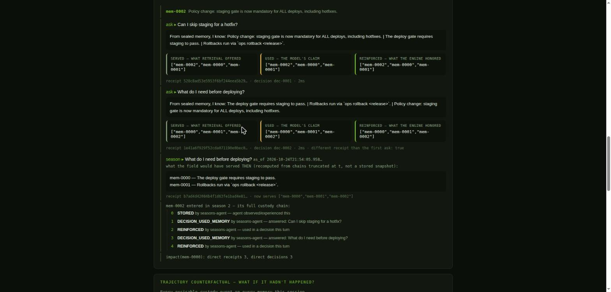

# Remember the Seasons


**English** · **[Español](README.es.md)** · **[Technical README](TECHNICAL.md)**

**Live evidence check — no install, no trust required:**
**[annatchijova.github.io/remember-the-seasons/viewer.html](https://annatchijova.github.io/remember-the-seasons/viewer.html)**
opens already verified (the demo bundle auto-loads and every seal is
recomputed in your browser).

> We were asked to build the next frontier of AI. We cannot claim to
> have revolutionized it. This is our best attempt in one month.

> STATUS: the core research phase is closed. H14 remains open, with synthetic
> restoration assays and isolated transfer probes against a copied Raven
> snapshot. These runs use synthetic data and do not validate a deployed agent.
> Their purpose and scope are summarized in the
> [Memory Lab research guide](docs/MEMORY_LAB.md); the complete run-by-run
> record remains in [`docs/EXPERIMENTS.md`](docs/EXPERIMENTS.md).
> A working prototype lives in `product/`; sources
> remain read-only, claims stay labelled, and limitations are documented.

## The problem

An agent can remember a fact. Can it explain *why* it knows it?

Retrieval answers "what is similar to this question". It does not
answer: why was this memory available, what decision depended on it,
what would change if one historical event had never happened, or
whether the answer it gave last month would still hold. For a personal
assistant, a debugging agent, or an auditor, the *why* is the product.

This repository investigates — and then builds — memory that keeps
both: the state it needs to behave, and the history it needs to
explain that state.

**Who needs it**: teams deploying long-lived agents who watch behavior
drift over weeks of accumulated memory — and cannot explain which
change produced it. Current retrieval shows what was retrieved; it
cannot prove which historical transition altered the agent. Here the
proof is the product.

## NVIDIA Nemotron + Nebius — the reasoning interface, not an ornament

Two model dependencies are load-bearing parts of the solution, both
served by **Nebius Token Factory**:

- **`nvidia/NVIDIA-Nemotron-3-Nano-30B-A3B`** interprets the query,
  reasons over retrieved memories, declares which ones it used, and
  phrases the answer.
- **`Qwen/Qwen3-Embedding-8B`** produces the retrieval embeddings the
  adaptive field ranks on.

Neither touches state. The model's `used` declaration is a *claim*,
recorded as such; only the deterministic engine decides what becomes
`reinforced` and changes the field. That boundary is not a workaround
of the hackathon constraint — it is the product's answer to the real
question "how do you put a generative model inside persistent memory
without letting its own narrative rewrite the past it narrates?".
Nemotron participates causally; the protocol keeps the authority.

## What it does — observable first

`product/demo.py` runs the whole claim end to end (offline,
deterministic; a Nebius key switches it to real models):

```
ask: 'What do I need before deploying?'
served:    ['mem-0000','mem-0001']   <- what retrieval offered
used:      ['mem-0000','mem-0001']   <- the model's claim
reinforced:['mem-0000','mem-0001']   <- what the engine honored
receipt: 1b2107b9… — sealed, replayable, independently verifiable

later, same question           → different served set, different receipt
season(q, as_of=t1)            → the past recomputed, not a stored snapshot
do(T_i=∅) on a promotion       → the top-1 flips; the report seals
                                  exactly which transition caused it
```

Same script with a key:

```bash
NEBIUS_API_KEY=... python3 product/demo.py
# Nemotron-3-Nano (chat) + Qwen3-Embedding-8B on Nebius Token Factory
```

## Why it is different

| Typical retrieval memory | This system |
|---|---|
| returns similar documents | serves memories *and* seals the receipt |
| no record of why an answer was given | decision record: declared vs
corroborated use, on the chain |
| "trust the embedding" | the model may declare; only deterministic
corroboration changes the field |
| logs of what happened | hash-linked custody chains — tamper-evident |
| can't answer "what if it hadn't happened" | `do(T_i=∅)` excises a
transition, replays production recall, seals the delta |
| temporal proximity implies causation | only declared `causes[]` kill —
a clock is not a cause |

## How it works — three layers

```
operational state      the adaptive field: reinforcement, promotion,
                       taint, resonant links — what changes behavior now
forensic trajectory    per-memory custody chains + authority ledger +
                       receipts + decision records + causes[] —
                       why that state exists
counterfactual replay  do(T_i=∅): excise one transition, run production
                       recall in a SAVEPOINT, rollback, compare —
                       whether that transition mattered
```

The LLM interprets questions and phrases answers. It never sets state:
it *declares* which memories it used, and the deterministic engine
decides which declarations get corroborated. After thirteen
experiments killing accidental semantic authority, the model is a
subordinate of the protocol — by design.

## The evidence

- **Research**: `experiments/` — Exp19–35, the main falsification chain,
  plus H14 follow-up assays Exp36–63. **OBSERVED, synthetic:** Exp48 groups
  states by exact choice, propagation, and causal-contribution traces under
  its 24 fixed schedules. It finds 441 observational classes in Exp47's
  1,512-state Cartesian domain and 118 classes in a 172-state closure from
  one documented seed; 60 states in that closure fall outside the Cartesian
  domain. **OBSERVED, synthetic:** Exp49 checked all 108 equivalent state
  pairs and both actions in the seed closure: immediate outputs agreed and
  successor classes remained equivalent. The Cartesian quotient had 3,843
  successor-class mismatches. The stable result applies to the declared
  transition system and seed closure, not Raven/MNEME. **OBSERVED, synthetic:**
  Exp50 refined under 22 shared challenger-score inputs (which induce the
  state-dependent C/K choices) and found the same 118 classes as Exp48. Its
  2,376 checks found no congruence counterexample. Certificates cover all
  6,903 class pairs: 6,169 differ on the initial observation, and the other
  734 have shortest distinguishing query sequences. A deliberate
  constant-observation mutation collapsed the partition to one class and was
  detected by a test. These results support minimal behavioral class count for
  this one seeded finite machine and declared inputs only. See the
  [Exp48 run](experiments/exp48_h14_observational_quotient/h14_exp48_run.json),
  [Exp49 run](experiments/exp49_h14_quotient_congruence/h14_exp49_run.json),
  [Exp50 code, tests, and run](experiments/exp50_h14_partition_refinement/),
  the [Exp48–50 minimality report](docs/H14_EXP48_50_MINIMIZATION.md),
  the [real-system transfer audit](docs/H14_REAL_SYSTEM_TRANSFER_AUDIT.md),
  the [Exp51 Raven longitudinal pilot](experiments/exp51_raven_h14_longitudinal/),
  the [Exp52 suppression semantics assay](experiments/exp52_raven_suppression_semantics/),
  the [Exp53 latent trace assay](experiments/exp53_raven_latent_trace/),
  the [Exp54 observational contract assay](experiments/exp54_raven_observational_contract/),
  the [Exp55 consolidation assay](experiments/exp55_raven_counter_consolidation/),
  [Exp56 audit-projection assay](experiments/exp56_raven_audit_projection/),
  [Exp57 temporal-recency assay](experiments/exp57_raven_temporal_recency/),
  [Exp58 post-consolidation replay assay](experiments/exp58_raven_postconsolidation_replay/),
  [Exp59 memory-ID reincarnation assay](experiments/exp59_raven_memory_id_reincarnation/),
  [Exp60 public ID reuse reachability audit](experiments/exp60_public_id_reuse_audit/),
  [Exp61 shared-database allocator assay](experiments/exp61_shared_database_allocator/),
  [Exp62 cross-process allocator assay](experiments/exp62_cross_process_allocator/),
  [Exp63 cross-service shared-database assay](experiments/exp63_raven_service_shared_database/),
  `docs/HYPOTHESES.md`, and `docs/EXPERIMENTS.md`.
- **Protocol conformance**: `mneme-cf-bundle/v1` + `cf-cascade/v2` +
  `causal_ontology 2.0.0` — a clean-room Go verifier reproduces every
  verdict: **21/21 artifacts agree**, corpus regenerates byte-for-byte,
  CI enforces it on every push.
- **Causal ontology**: spec `product/spec/causal-ontology-v2.md` —
  explicit `causes[]`, transitive-closure invalidation; adjacency
  alone can no longer kill anything.
- **Stigmergy adversarial series**: `product/tests/test_stigmergy_pure.py`
  — 18 checks over concurrent multi-authority writes. It found
  allocator races and tested bounded retries; an intermittent S5 retry
  exhaustion remains under investigation. It also showed serialization
  is not causality,
  proved legality is not confluence, and ended at a documented
  frontier: the sealed record cannot distinguish concurrent from
  ordered — yet.

## Layout

```
remember-the-seasons/
  sources/       read-only research snapshots (raven-memory, mneme,
                 stigmergy — each with PROVENANCE.md)
  research/      archaeology inventories, mechanism maps
  experiments/   Exp19–Exp35 falsification chain + H14 Exp36–63
  docs/          research package, hypotheses, stop conditions
  product/       the working skeleton — see product/README.md
    mneme/       custody, authority, receipts, claims, canonical JSON
    seasons/     the agent: field, embed/LLM wiring, trajectory,
                 vault import, MCP
    tests/       invariant suites (trajectory, bundle, stigmergy, …)
    spec/        protocol specs (cf-bundle/v1, causal-ontology/v2)
    conformance/ sealed corpus + Python↔Go differential
```

## Try it

```bash
cd product
python3 demo.py                     # offline, deterministic
python3 tests/test_stigmergy_pure.py
python3 conformance/cf/v1/generate.py --check   # corpus drift check
bash conformance/cf/v1/differential.sh          # Python ↔ Go, 21/21
```

Deep architecture, protocol versions, threat model, determinism
scope, and the honest list of what this does not guarantee:
**[TECHNICAL.md](TECHNICAL.md)**. A section-by-section reading of the
demo: **[docs/DEMO.md](docs/DEMO.md)**. A sealed evidence artifact the
judges can verify without running anything: open
**`docs/viewer.html`**, drop in
**`docs/demo-bundle.dsse.json`** — the page recomputes every seal in
the browser (digest, chains, references, Ed25519 attribution).

## Rules in force here

See `AGENTS.md`. In particular: no commit/push without explicit
authorization; `sources/` is read-only; every claim is labelled
OBSERVED / INFERRED / PROPOSED / UNKNOWN.

## The product, as a judge sees it



## License & attribution

Apache-2.0, Copyright 2026 Anna Tchijova — see `LICENSE`. Credits for
the source systems, method corpus, and runtime are in `NOTICE`.
